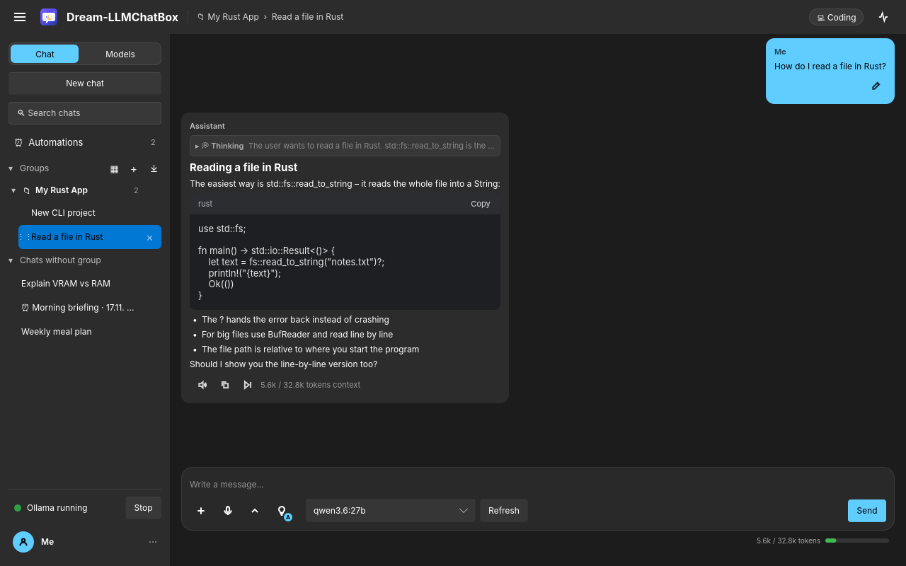
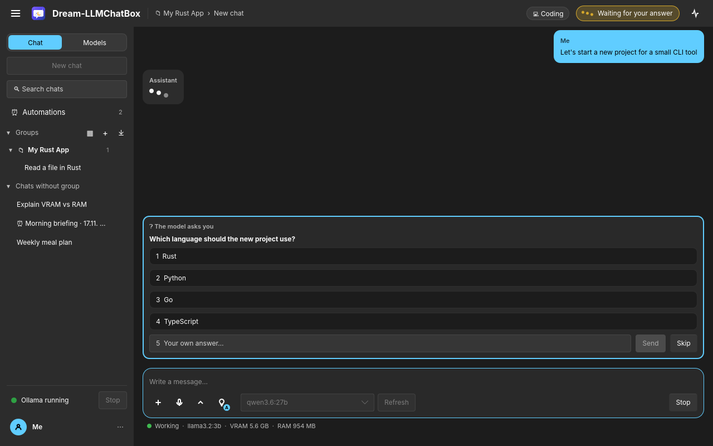
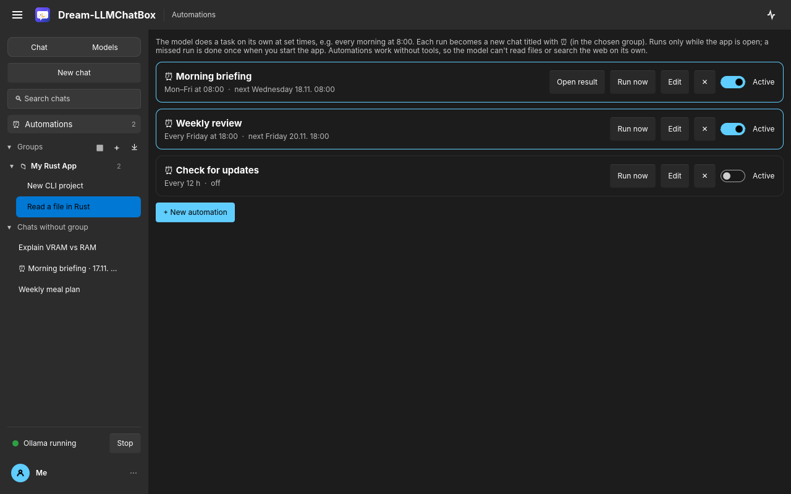
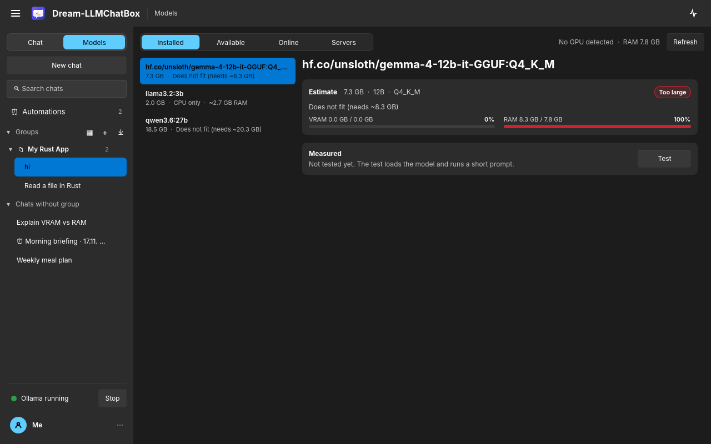
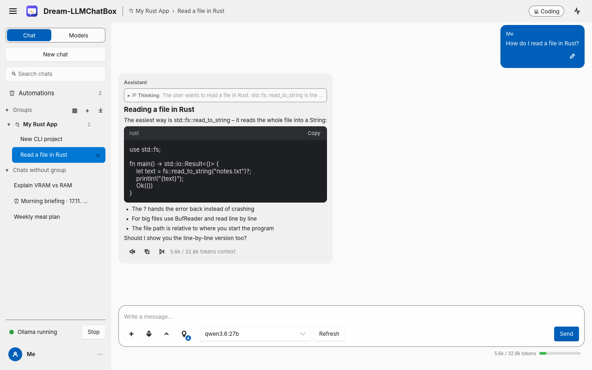

# Dream-LLMChatBox

**A desktop chat app for local AI models – with tools, memory, groups, a test environment and automations.**
Rust + Slint, runs on Linux, works with [Ollama](https://ollama.com) and every OpenAI-compatible local server.



<p>
  
  
</p>
<p>
  
  
</p>

## Install

```bash
curl -fsSL https://raw.githubusercontent.com/yakuda-stack/Dream-LLMChatBox/main/install.sh | bash
```

The script detects your distro (Arch, Fedora, Debian/Ubuntu, openSUSE), installs the build dependencies, gets a current Rust if needed, builds the app and installs it into the system (`/usr/local/bin/dream-llmchatbox`, app menu entry and icon). If Ollama is missing, it offers to install it. Run the same line again to update.
Uninstall: `curl -fsSL https://raw.githubusercontent.com/yakuda-stack/Dream-LLMChatBox/main/install.sh | bash -s -- uninstall` (your chats and settings stay).

Other ways:

- **Arch / CachyOS (AUR):** `yay -S dream-llmchatbox` (or paru)
- **AppImage by hand:** download `Dream-LLMChatBox-<version>-x86_64.AppImage`, `chmod +x` it and start it. It adds itself to the app menu and supports delta updates (AppImageUpdate / Gear Lever via the `.zsync` file)
- `dream-llmchatbox --version` shows the version

You also need [Ollama](https://ollama.com) (or another local server) and at least one model, e.g. `ollama pull qwen3:8b`. If Ollama is missing, the app shows an "Install" button.

## Why this app?

I built Dream-LLMChatBox as a tool for myself. I wanted one app for local models that does everything I need: chat, coding in my real projects, remembering things, working safely in a copy of a project, and doing tasks on its own. I didn't find an app that had all of that together, so I wrote it.

It's open source. Anyone can use it, change it and share it, under the terms of the [GPL-3.0 license](LICENSE) (changed versions must stay open source under the same license).

## What makes it different

Simple local chat apps (like Alpaca) are great for chatting. Dream-LLMChatBox goes further – these things are rarely found together in one local app:

- 🧪 **Test environment** – the model works on a copy of your project, you see a diff and apply the changes yourself. Optional: commands run in a Podman/Docker container
- 🗂 **Groups with memory** – one group per project, with its own folder, rules and Markdown memory the model reads and writes (also works with Obsidian)
- 🗜 **Chat compression** – long chats are summarized automatically, so you can keep chatting without losing the start
- ⏰ **Automations** – the model does tasks on its own on a schedule (e.g. a morning briefing)
- 🛠 **Real tools with approval** – files, terminal, web search, MCP servers and your own bash tools; everything risky asks first
- ↶ **Checkpoints** – every file change of the model can be undone with one click
- ❓ **Questions to click** – the model asks you with numbered answers instead of guessing
- 📚 **Searchable documents (RAG)** – the model finds passages in your PDFs, DOCX and notes by meaning
- 📏 **Hardware check** – every model shows if it fits into your VRAM/RAM and how fast it will be, with a real test button
- 🔀 **Auto-Switch** – a small model picks the best installed model for each message
- 🌍 **German and English**, guided tour, dark/light mode

## Features

### Chat

- Streaming answers, stop button, "Continue" near the context limit
- Markdown with headings, lists and code blocks with "Copy"
- Thinking switch per chat: Auto / On / Off; the thinking is shown in a collapsed "💭 Thinking" box
- Edit and resend your last message, read answers aloud (local Piper voices), copy the whole answer
- Copy from the chat: select + Ctrl+C, or right-click → Copy / Select all
- Text input grows up to 8 lines, Enter sends, Shift+Enter makes a new line
- Ctrl+V pastes images and files as attachments
- Attachments: text, code, PDF, images (vision models), whole folders, audio and video (transcribed)
- Models without image support get images as text (color grid, colors, OCR via `tesseract`)
- Microphone with local speech recognition (whisper.cpp), live text while speaking, mic selection, level meter, language and gain
- Context bar below the input (green → orange → red)
- Automatic short chat titles, chat search (title and text), export as Markdown
- Errors from Ollama are shown with the real message; the chat keeps working

### Long chats and context

- **Chat compression:** at 80 % context (changeable) older messages are summarized, the newest stay word for word; by hand with "🗜 Compress"
- Context length setting (default 64K); not enough VRAM → other models are unloaded, then the context is halved until it fits
- Saves tokens in long tool runs: files are not read twice, old tool results are shortened, thinking is not sent back
- Loop guard and a pause after 10 tool steps in a row, both with "▶ Continue"
- No more typing "continue": if the model only announces a step ("Let me look at …") or stops after a word or two, the app tells it to go on (up to 2 times per answer, only in chats with a shared folder)
- Short follow-ups like "weiter" are judged together with your last messages, so Thinking and Auto-Switch don't drop to "simple chat"; in Coding mode a task is never treated as simple chat
- `pause_and_wait`: the model can wait for something and continues automatically at a set time

### Groups, memory and profiles

- **Groups** (e.g. one per project): standard folder, own rules, purpose (Other / Coding), collapsible in the sidebar
- Groups page with all groups at a glance; export / import groups (with or without chats)
- **Group memory:** Markdown notes the model reads and writes with `memory_list`, `memory_search`, `memory_read`, `memory_write`
- **Global memory:** the model knows where your projects are (`list_projects`) and asks for access (`request_project_access`)
- **Start arguments:** short points every model gets at the start; global or per group; the model can add points with `remember`
- Answer styles ("Answer like an online AI": Claude, Gemini, ChatGPT, Grok, DeepSeek or your own `.md` file)
- **Profiles:** each with its own chats, groups, memory, name, "about you" and picture
- Pin, sort (drag), multi-select and merge chats into a new group

### Coding

- Coding mode: the model reads `ARCHITEKTUR.md` / `ARCHITECTURE.md` and `ROADMAP.md` first, or writes them from a template
- Architecture index: headings and module list right away, the full file only when needed
- Tools: `search_files` (like grep, same paths as `read_file`, hints at `regex` when `a|b` finds nothing), `edit_file` (only the changed part, shows the result with line numbers and blocks duplicate edits), `write_file`, `create_document` (PDF, DOCX, ODT, PPTX, HTML, EPUB via pandoc)
- **Terminal commands** with approval ("Yes, once" / "Allow in this chat" / "No"); safe commands like `cargo test` run without asking; `sudo`, `rm -rf /`, paths outside the folder and `curl … | bash` are always blocked; up to 15 minutes with a timer
- **Automatic check (Rust):** after file changes the app runs `cargo clippy` and lets the model fix errors and warnings (max. 3 rounds); 20 tool steps per answer in Coding mode
- **Checkpoints:** "↶ Undo file changes" puts every file back
- Preview tab: images, SVG, PDF pages, Markdown and code the model wrote

### Test environment (sandbox)

- "🧪 Test environment" switch for a new chat: the model works on a copy of your project (`~/DreamWork/<group>/<chat>`)
- "📝 n changes in work folder" shows a diff with "Apply to project"
- No approval questions inside the test environment: the model may create and change files there freely (your project is only changed with "Apply to project"); with the container on, terminal commands run without asking too
- Read-only projects: the app offers a work folder automatically
- "🔄 Sync before each message" (next to the folders below the input): before every message the app copies your current project files into the test environment and tells the model – handy when you take over changes yourself in your project
- `sync_from_project`: the model copies files from your original project into the test environment when they are missing or differ there (one file, a folder or everything; never changes your project, runs without asking)
- Per group: a test environment for every chat
- **Container** (Settings, off by default): commands run in Podman or Docker, image changeable (default `debian:stable-slim`)
- **🛡 Sandbox** (per group, on by default; per chat in the chat settings): terminal commands run with `bwrap` and can only write into the shared project folder; `~/.ssh`, `~/.gnupg` and keyrings are hidden (needs `bubblewrap`)
- Right-click on a chat: "✏ Rename" and "⚙ Chat settings…" (name, group, shared folders, memory folder, sandbox switch)

### Tools, web and MCP

- Built-in tools: time, calculator, hardware info, files, terminal, web, memory, documents – each can be switched off or fully edited
- Your own tools: name, description, parameters and a bash command; one file per tool, import / export as JSON
- **Web access with approval:** `web_search` (DuckDuckGo) and `open_web_page`; local and home network addresses are always blocked
- Browser panel: see every search and page as clean text, browse yourself
- **MCP servers** over stdio (same format as Claude Desktop, import from Claude Desktop), every call asks first
- **Questions to click:** `ask_user` shows up to 4 answers plus your own answer
- Activity panel: what the model is doing right now and a list of all steps per chat

### Searchable documents (RAG)

- A document folder per group: PDF, DOCX, ODT, Markdown, text and code are indexed with an Ollama embedding model (default `nomic-embed-text`)
- `search_documents` finds passages by meaning and names file and line; changed files are indexed again automatically

### Automations

- Every day, on weekdays, once a week or every few hours (e.g. a morning briefing)
- Each run becomes a new chat "⏰ name · date" in the chosen group, with a desktop notification
- Per automation: model, group, "Run now", "Open result", on/off; a missed run is done once at the next start

### Models and servers

- **Installed:** size, VRAM/RAM and speed estimate, "Test" measures real VRAM/RAM and tokens per second, "Remove" deletes the model (asks once more)
- **Available:** curated list plus live search on ollama.com and Hugging Face (GGUF), filters and model families; one-click install
- Two bars per size: share of your VRAM and your RAM
- **Servers:** LM Studio, llama.cpp, vLLM, LocalAI or another PC (OpenAI-compatible API), with tools and thinking
- **Online:** Claude Code, ChatGPT (Codex CLI), Gemini CLI and Grok CLI with your own account
- **Auto-Switch (BETA):** a small model rates each message and the best fitting model answers
- Start/stop Ollama at the bottom left; graphics backend Automatic / Vulkan / ROCm / CPU
- Ollama runner crash: one automatic retry with a smaller context, then a help text

### App

- **Appearance:** System (default), Light or Dark – Settings → Appearance
- German and English, chosen on the first start or in Settings → Language
- Guided tour on the first start (start it again in Settings)
- App icon and desktop entry for Wayland (KDE, GNOME)
- Reset everything (with a clear warning); your project folders and Ollama models stay
- Chats are saved in SQLite (`~/.local/share/dream-llmchatbox/profiles/<profile>/chats.db`); deleting a chat frees all its files

## Notes

- VRAM, RAM and speed values are rough estimates. GPU detection: NVIDIA via `nvidia-smi`, AMD/Intel via sysfs.
- The ollama.com search reads the public website, so it may break if the site layout changes.
- The internet is only contacted when you search models, use web tools (with approval), or download a speech model or voice.
- Optional programs: `ffmpeg` (audio/video), `pdftotext` (PDF), `tesseract` (OCR), `pandoc` (documents), `piper-tts` (read aloud), `podman`/`docker` (container), `bubblewrap` (sandbox).
- A larger context length uses more VRAM.

## Build

Build dependencies: Rust, `cmake` and `clang` (for whisper.cpp), ALSA headers (`alsa-lib`).

```bash
cargo run --release
```

Release files: `bash scripts/build_appimage.sh` builds `build/Dream-LLMChatBox-<version>-x86_64.AppImage` + `.zsync`; `python3 scripts/bump_version.py <version>` sets the version in `Cargo.toml`, `Cargo.lock` and `packaging/aur/PKGBUILD`. AUR steps: [packaging/aur/README-AUR.md](packaging/aur/README-AUR.md).

## More

- [ROADMAP.md](ROADMAP.md) – what is planned
- [CHANGELOG.md](CHANGELOG.md) – what changed
- [ARCHITEKTUR.md](ARCHITEKTUR.md) – how the code is built

## Contributors

- **Yakuda** ([yakuda-stack](https://github.com/yakuda-stack)) – idea, design, testing, maintainer
- **Claude** (Anthropic) – AI pair programmer

## AI disclosure

About 90 % of this program was developed together with Claude (Anthropic). I planned the features, tested everything on my own PC and decided what goes in; Claude wrote most of the code.

## License

[GPL-3.0-or-later](LICENSE) – free to use, change and share; changed versions must stay open source under the same license.
